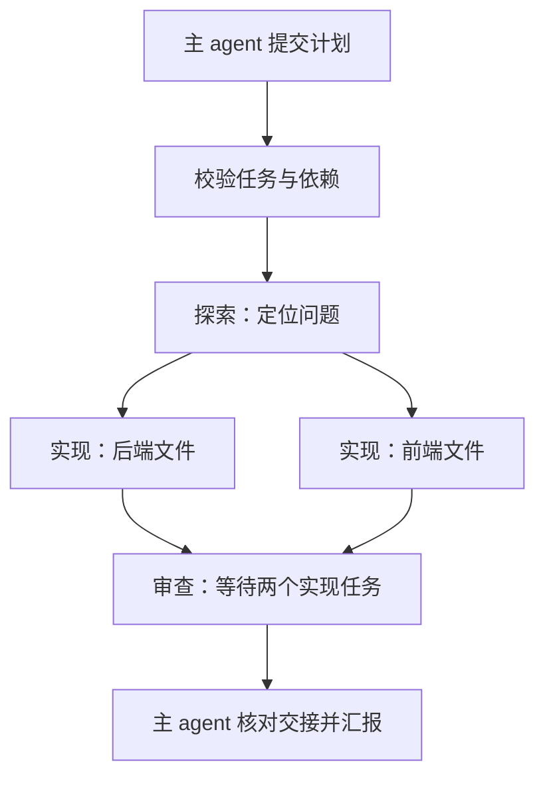

# 从一次请求理解架构

学习目标是能沿代码解释：用户输入如何到达模型，模型提出的工具请求如何执行，结果如何回到页面。建议先看主干，再看异常处理。

## 1. 入口：cli.py

`python -m mini_nanobot web` 经过 `__main__.py` 调用 `cli.main()`。`config.load_settings()` 读取 `.env` 和已有配置。`web()` 启动同一进程内的 aiohttp 服务；开发模式额外启动 Vite。网页和终端都使用 AgentService，没有两套 agent 逻辑。

## 2. 请求：server.py → agent.py

网页发送 `POST /api/sessions/{id}/chat`。服务校验本机访问码、请求来源和参数，然后调用 `AgentService.start()`。每个会话同一时间只运行一个主任务，不同会话可独立调度。任务以 asyncio Task 运行，因此模型或命令等待期间仍能响应停止请求。

当前不再使用旧版 MessageBus、渠道管理器和 WebSocket 复用协议。HTTP 响应保持连接，按行发送 JSON 事件。前端的 `api.readEvents()` 保留跨网络分块的 UTF-8 和行缓冲，逐条处理文本、工具、子任务与结束事件。

## 3. 执行：runner.py

`AgentRunner.run()` 是核心循环：准备上下文 → 调用模型 → 如果有工具调用则执行并把结果加入消息 → 再次调用模型 → 获得最终答复。每轮都受最大迭代次数限制，工具结果也有长度上限。模型输出因长度截断时最多续接两次，仍无法完成就明确报错。

模型调用只经过 `provider.ModelProvider.complete()`。这个类把流式 Chat Completions 响应还原为 assistant 消息及 tool_calls，保留 DeepSeek 思考模式所需字段。暂时性网络错误只在尚未对外产生输出时有限重试，避免重放半段回复。

## 4. 工具：tools/

先读 `base.Tool`，理解工具名称、用途、JSON Schema 和 execute 方法。再看 `registry.build_tools()`，它直接列出每个角色能使用哪些工具。最后看 `filesystem.py` 和 `shell.py` 的具体操作。读取组可并发；带写入或其他副作用的工具组按顺序执行。

文件通过 `security.resolve_path()` 检查解析后的实际路径。写入使用同目录临时文件和原子替换，精确修改要求旧文本唯一匹配。Shell 使用受限环境变量启动命令；停止和超时会清理整个进程组。系统沙箱是独立模块，应用层过滤不能替代系统隔离。

## 5. 子任务：subagents.py

主模型调用 subagent 工具时，SubagentManager 创建独立的用户任务消息、中文角色说明和受限工具集，再复用相同 AgentRunner。调度单元是 asyncio Task，服务实例的全局信号量限制子任务并发。工具权限决定探索和审查角色无法写入或执行命令。

第一阶段增加了 `plan` 操作。先读 `task_graph.validate_plan()`：它检查每项格式、重复 ID、缺失的前置任务和循环依赖，整批有效后才登记任务。再读 `subagents.dependencies_ready()`：下游先等待前置的完成事件，再争取并发名额。所有前置均为 done 才能启动，前置失败或待处理则阻断下游。

这张图的后端和前端任务可以并发，但应分配不同文件；仅有依赖调度还不能隔离共享文件。

交接不是简单拼接上一位 agent 的自然语言：计划中的子任务按 JSON 协议提交完成声明、摘要和未解决问题。`ToolResult` 从文件与命令工具携带执行证据，runner 发送工具事件，manager 汇总为 `handoff()`。下游上下文自动加入前置交接。主 agent 使用 `check(task_id)` 获取完整交接；前端把同样的数据展示成中文卡片。

状态流为：排队 → 等待前置（如有）→ 执行 → 完成 / 待处理 / 错误 / 取消；前置未完成时进入“前置阻断”。“完成”表示执行结束且角色提交了有效完成声明，验收要求仍由角色判断；实际命令记录可供核对。阶段一没有自动执行验收脚本或自动重试。

需要立即结果时主任务等待子任务；后台子任务允许主任务继续执行，在最终答复前回收结果并再让模型汇总。停止主任务会取消其子任务。图只在当前请求内调度，进程重启不会重新执行任务图。依赖、状态、交接与工具证据会保存为会话事件。角色共享文件目录，没有自动 worktree 隔离，也没有按角色使用不同模型。

## 6. 状态：session.py 与 context.py

SessionStore 是 SQLite 的唯一读写入口。`sessions` 表保存消息、摘要和运行状态；`events` 表保存工具活动和子任务结果；`memory` 表以代码目录为键保存跨会话项目记忆。精简版独立数据文件不会改动旧版会话库。

`context.build_system()` 组合身份、当前目录、AGENTS.md、项目技能和记忆。`compact()` 按粗略预算生成摘要，压缩时保留完整工具调用组。未配对的工具记录表示可能中断，下一轮要求先检查效果，不自动重复执行。摘要属于上下文管理，项目记忆属于长期信息存储，二者用途不同。

## 推荐阅读顺序

1. `cli.py`：知道程序从哪里开始。
2. `tools/base.py` 和 `tools/registry.py`：知道模型能做什么。
3. `provider.py`：知道怎样请求模型。
4. `runner.py`：看懂模型与工具的循环。
5. `agent.py`：理解会话、停止和检查点。
6. `task_graph.py`、`subagents.py`：理解计划校验、依赖等待和结构化交接。
7. `server.py`、`webui/src/api.ts`、`App.tsx`：串起完整前后端。
8. 配合 `tests/test_agent.py`、`tests/test_task_graph.py` 观察可控模型如何走完探索、实现、命令验证和审查。
